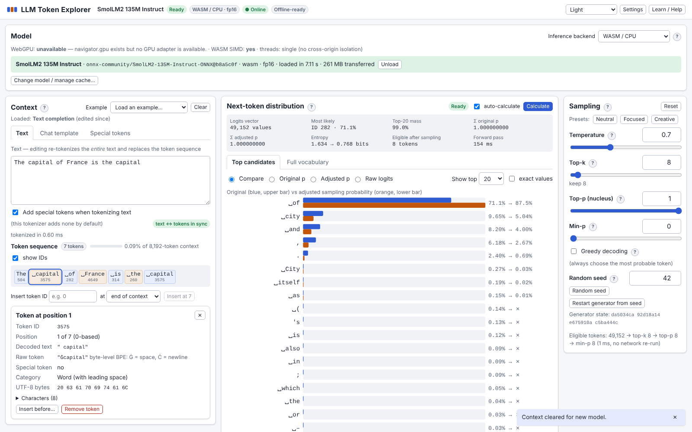
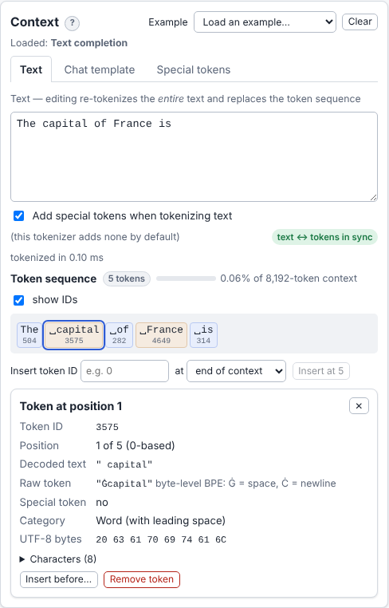
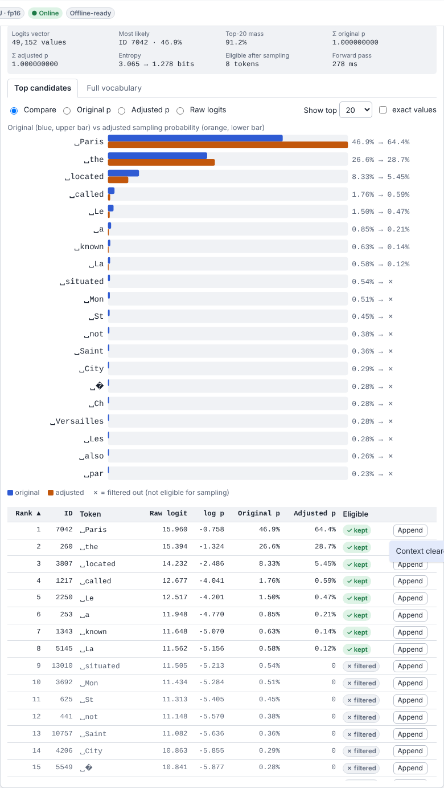
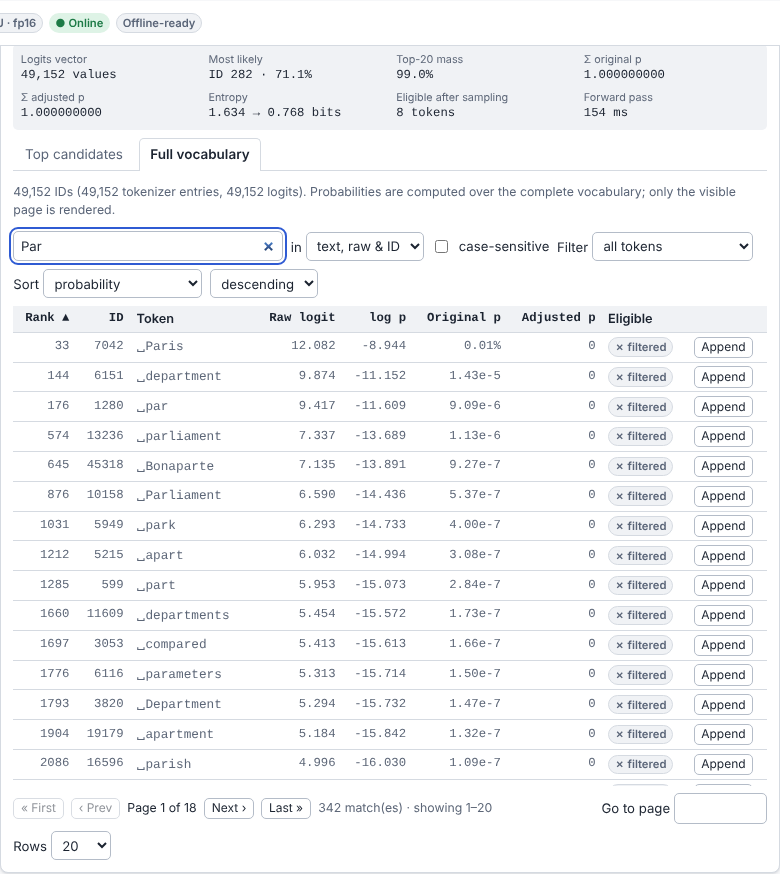
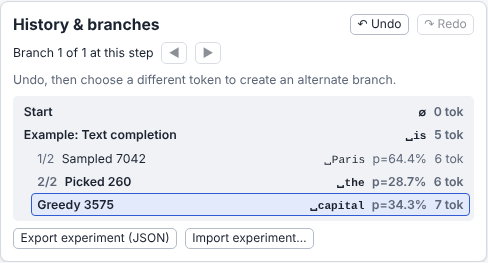

# LLM Token Explorer

An interactive, fully client-side workbench for seeing what a language model actually
does: how text becomes token IDs, what **logits** the network outputs for the next token,
how **softmax** turns them into probabilities, how **temperature / top-k / top-p / min-p**
reshape them, and how generation is just _pick a token, append its ID, run again_.

Real neural-network inference runs **in your browser** (Transformers.js + ONNX Runtime Web,
WebGPU or WebAssembly). No server, no API key, no Python, no Ollama.

**Live app: https://pcowhill.github.io/llm-token-explorer/**



## Features

- **Real next-token logits** for the complete vocabulary from a raw forward pass (not
  `generate()`), with the logits shape, timing and backend shown in diagnostics.
- **Original vs. adjusted distributions** side by side (chart + sortable table with raw
  logits, log-probabilities, original and adjusted probabilities, eligibility), exact values
  on demand.
- **Sampling controls**: temperature, top-k, top-p, min-p, greedy, seeded reproducible PRNG —
  recomputed instantly from cached logits without re-running the network.
- **Exact token-ID context**: color-coded token chips, keyboard editing, token inspector
  (ID, position, escaped text, raw token, UTF-8 bytes, code points, category), insert by ID.
- **Special-token browser** populated from the tokenizer's metadata; inserts real IDs.
- **Model-specific examples** (an action menu: pick one, pick it again) and the tokenizer's
  **real chat template**, including template options such as Qwen3.5's `enable_thinking`.
  Loading a model starts a clean workspace with its default starter example.
- **Full vocabulary explorer**: search by text / raw token / ID, sort by probability,
  adjusted probability, logit, ID or alphabetically, filter, paginate — append any token.
- **Generation**: manual pick, sample one token, append argmax, automatic generation with
  max length, stop button, tokens/s and correct stop-token handling.
- **Keyboard shortcuts**: <kbd>S</kbd> samples a token, <kbd>G</kbd> appends the most likely
  one — hold to keep generating (each token waits for its forward pass). Remappable in
  Settings; <kbd>?</kbd> lists every shortcut.
- **History & branching**: undo/redo, alternate branches, tree navigation; experiment
  **export/import** (validated JSON).
- **Models**: curated, revision-pinned catalog with verification status and measured
  quantization fidelity; any Hugging Face ONNX repo (the available quantizations, their
  sizes and a recommended dtype are read from the Hub API); **local files / folders** (never
  uploaded); tokenizer-only mode; cache management. Every quantization shows whether it is
  already cached (“✓ cached” / “↓ 257 MB”).
- **Broken output is never shown as a distribution**: NaN, infinite or constant (e.g.
  all-zero) logits are reported as an error instead of a uniform distribution.
- **Diagnostics**: load/tokenize/inference/sampling times, tensor shapes, GPU adapter,
  storage, cache state — measured values distinguished from estimates.
- **Offline-capable PWA**, light/dark themes, keyboard navigation, accessible markup,
  built-in explanations (Learn / Help) with a sampling playground.

| Tokenized context & inspector                              | Probability workspace                                             |
| ---------------------------------------------------------- | ----------------------------------------------------------------- |
|       |  |
| **Vocabulary explorer**                                    | **History, sampling, diagnostics**                                |
|  |             |

More: [model selection](docs/screenshots/01-model-selection.png),
[sampling controls](docs/screenshots/04-sampling-controls.png),
[diagnostics](docs/screenshots/07-diagnostics.png), [dark theme](docs/screenshots/08-dark-theme.png),
[cache state per quantization](docs/screenshots/09-cache-per-quantization.png),
[cache tab](docs/screenshots/10-cache-tab.png),
[Hugging Face repo](docs/screenshots/11-hugging-face-repo.png),
[keyboard shortcuts](docs/screenshots/12-keyboard-shortcuts.png).

## Recommended models

| Model                                                                                                                                                                                                        | Params | Default precision (download)          | Vocabulary (tokenizer / logits) | License    | Real inference verified (Chromium)                             |
| ------------------------------------------------------------------------------------------------------------------------------------------------------------------------------------------------------------ | ------ | ------------------------------------- | ------------------------------- | ---------- | -------------------------------------------------------------- |
| **★ Patrick's Choice:** [Qwen3.5 0.8B](https://huggingface.co/Qwen/Qwen3.5-0.8B) ([ONNX](https://huggingface.co/onnx-community/Qwen3.5-0.8B-Text-ONNX/tree/25cdf33f386b487a25f3d743e86442517bdb77ff))        | 0.8B   | fp32 on WebGPU (2.9 GB); WebGPU only  | 248,077 / 248,320               | Apache-2.0 | ✅ WebGPU-SwiftShader (fp32/q8/q4); CI (fp32)                  |
| [SmolLM2 135M Instruct](https://huggingface.co/HuggingFaceTB/SmolLM2-135M-Instruct) ([ONNX](https://huggingface.co/onnx-community/SmolLM2-135M-Instruct-ONNX/tree/b8a5c0f183b78c55955a5364f610c36668b5e681)) | 135M   | fp16 on WASM (257 MB), fp32 on WebGPU | 49,152 / 49,152                 | Apache-2.0 | ✅ WASM (fp16/fp32/q8/q4f16), WebGPU-SwiftShader (fp32/q8); CI |
| [Qwen2.5 0.5B Instruct](https://huggingface.co/Qwen/Qwen2.5-0.5B-Instruct) ([ONNX](https://huggingface.co/onnx-community/Qwen2.5-0.5B-Instruct/tree/22942cb7d7ba4cc81bb4673549ca4d4614469b5e))               | 494M   | bnb4 (728 MB)                         | 151,665 / 151,936               | Apache-2.0 | ✅ WASM (bnb4/q4/q4f16/q8), WebGPU-SwiftShader (bnb4/q4/q8)    |
| [GPT-2](https://huggingface.co/openai-community/gpt2) ([ONNX](https://huggingface.co/onnx-community/gpt2-ONNX/tree/1975fb9b4a2a92bd99f457407337ee25ab6cfde0))                                                | 124M   | fp16 on WASM (238 MB), fp32 on WebGPU | 50,257 / 50,257                 | MIT        | ✅ WASM (fp16/fp32/q8), WebGPU-SwiftShader (fp32/q8)           |

Each default is the most faithful variant that runs on that backend (measured KL divergence
against fp32). f16 variants on WebGPU (fp16, q4f16) need the `shader-f16` GPU feature and are
**not verified in CI** — CI's only GPU is the SwiftShader software adapter. SmolLM2's and
Qwen2.5's fp16/q4f16 exports are not offered on WebGPU at all: they overflow fp16 there and
return all-zero or corrupted logits. Details, the measurements and a manual GPU checklist:
[docs/model-compatibility.md](docs/model-compatibility.md).

## Supported browsers

- **Chrome / Edge 113+** (desktop): WASM and WebGPU. Recommended.
- **Firefox, Safari**: WASM/CPU works; WebGPU depends on version/platform (Safari 26+,
  Firefox 141+ on Windows).
- Mobile browsers work for the small models but are slow and memory-limited.

## Quick start (using the app)

1. Open the live app. With a GPU, pick **★ Qwen3.5 0.8B** (WebGPU, 2.9 GB, or q8 at
   0.9 GB); on any device, **SmolLM2 135M Instruct → Download & load** (≈ 260 MB, cached
   afterwards: the button then reads “Load model (cached)”). Use **Tokenizer only** to explore
   tokenization without downloading weights.
2. The model's starter example is loaded. Type in **Context → Text** or choose another
   **Example** (completion, Q&A, chat template, thinking on/off, special-token demo). The
   colored chips are the exact token IDs; click one to inspect it.
3. The **Next-token distribution** is calculated automatically (or press **Calculate** /
   <kbd>Ctrl</kbd>+<kbd>Enter</kbd>).
4. Move **Temperature, Top-k, Top-p, Min-p** and compare original (blue) and adjusted
   (orange) probabilities.
5. Click **Append** on any row, **Sample 1 token** (<kbd>S</kbd>), **Append most likely**
   (<kbd>G</kbd>), or **Start** automatic generation. Hold <kbd>S</kbd> to watch the text
   grow one sampled token at a time.
6. Browse every token in **Full vocabulary**; insert special tokens under **Context →
   Special tokens**.
7. **Undo**, choose a different token to branch, and **Export experiment** to save it.

## Development

Requires Node.js ≥ 20.19 (22 recommended) and npm.

```bash
npm install            # .npmrc skips onnxruntime-node's optional CUDA download
npm run dev            # http://localhost:5173/llm-token-explorer/
npm run build          # type-check + production build into dist/
npm run preview        # serve the production build
npm run lint           # ESLint (zero warnings)
npm run typecheck      # vue-tsc, strict mode
npm run format:check   # Prettier
npm run test           # unit + component tests (Vitest)
npm run test:unit
npm run test:component

# End-to-end (Playwright, Chromium)
npx playwright install chromium
npm run fetch-test-models -- --smollm2   # pinned tiny fixture + SmolLM2 files (git-ignored)
npm run test:e2e       # workflow, accessibility, PWA/offline (tiny real ONNX fixture)
npm run fetch-test-models -- --qwen35    # + Qwen3.5 fp32 (3.1 GB) for its WebGPU test
npm run test:e2e:real  # real SmolLM2 (WASM + WebGPU) and Qwen3.5 (WebGPU) inference tests
npm run fetch-test-models -- --all       # every variant of every catalog model (~12 GB)
VERIFY_ALL_MODELS=1 npx playwright test --project=real-inference catalog  # every model × dtype × backend
node scripts/measure-fidelity.mjs <catalog-key>   # KL divergence of each variant vs fp32 (Node.js)
LIVE_ONLY=1 npm run test:e2e:live           # smoke test the deployed site
npm run check          # lint + typecheck + unit/component tests + build
```

Behind an HTTPS proxy with Node ≥ 22.21, run the fetch script with `NODE_USE_ENV_PROXY=1`.
Set `BASE_PATH=/` to build for a domain root. `node scripts/capture-screenshots.mjs`
regenerates the documentation screenshots from a running preview.

### Test layers

| Layer                                                     | Tool                    | What is real                                                                                                                                                                                                                            |
| --------------------------------------------------------- | ----------------------- | --------------------------------------------------------------------------------------------------------------------------------------------------------------------------------------------------------------------------------------- |
| Unit (`tests/unit`)                                       | Vitest                  | Pure math & data structures with known expected values.                                                                                                                                                                                 |
| Component (`tests/component`)                             | Vitest + Vue Test Utils | UI behaviour with a **fake engine** (synthetic logits) — not inference evidence.                                                                                                                                                        |
| E2E (`tests/e2e/workflow`, `interactions`, `a11y`, `pwa`) | Playwright              | Production build, real worker and ONNX Runtime, using a **tiny random-weight** GPT-2 fixture loaded through the local-files path (keyboard shortcuts, Example menu, workspace reset, Hub dtype detection with a mocked API, axe scans). |
| Real inference (`tests/e2e/real-inference`)               | Playwright              | **Real SmolLM2 and Qwen3.5 weights**: logits dimension, softmax validity, expected top tokens, append + further passes, offline load from cache.                                                                                        |
| Catalog verification (opt-in)                             | Playwright              | Every catalog model × quantization × backend with real weights.                                                                                                                                                                         |
| Live (`tests/e2e/live`)                                   | Playwright              | Deployed GitHub Pages site incl. one real inference pass.                                                                                                                                                                               |

## Deployment architecture

Static files only. GitHub Actions (`.github/workflows/ci.yml`) runs lint, format, strict
type-check, unit and component tests and the production build; then Playwright e2e and
real-inference tests (pinned models cached between runs); on `main` it builds with the Pages
base path, deploys with the official Pages actions and finally runs the live smoke test
against the deployed URL. Actions are pinned to commit SHAs; jobs use minimal permissions.
See [docs/architecture.md](docs/architecture.md).

## Privacy

Everything runs locally. Prompts, token sequences and locally selected model files never
leave your device. The only network requests are the app's own static files and — when you
ask for a model — files from `huggingface.co`. No analytics, telemetry or tracking. Session
settings/history are kept in `localStorage` (can be disabled/cleared in Settings).

## Offline behaviour

After the first visit the app shell works offline (service worker). Models loaded once are
kept in Cache Storage and load offline; local files always work offline. Manage cached
models under **Model → Cache**. Details: [docs/caching-and-offline.md](docs/caching-and-offline.md).

## Known limitations

- WebGPU on hardware GPUs and Firefox/Safari were not tested automatically (CI has no GPU);
  only Chromium WASM and the SwiftShader software WebGPU adapter were exercised. In
  particular **f16 variants on WebGPU are not verified** (SwiftShader lacks `shader-f16`).
- Qwen3.5 needs WebGPU: none of its exports runs on WASM (memory, and a missing
  `GatherBlockQuantized` kernel in ONNX Runtime Web's WASM build).
- WASM is single-threaded on GitHub Pages (no COOP/COEP headers → no `SharedArrayBuffer`).
- Quantized variants (q8, q4, bnb4) only approximate the full-precision distribution; Qwen2.5
  cannot run unquantized on WASM (exceeds WebAssembly memory).
- Each forward pass re-processes the whole context (the optional KV cache is off by default
  for exactness), so long contexts get slower.
- Only decoder-only causal LMs in Transformers.js ONNX layout are supported; no GGUF /
  safetensors conversion in the browser.
- Repetition penalty and other logits processors beyond temperature/top-k/top-p/min-p are not
  implemented.
- Private/incognito windows may not cache large model files.
- Sampling results are reproducible only for identical logits (same backend and precision).

## Documentation

- [Architecture](docs/architecture.md) · [Research notes](docs/research.md)
- [Logits vs. probabilities](docs/logits-and-probabilities.md) · [Sampling pipeline](docs/sampling.md)
- [Special tokens](docs/special-tokens.md) · [Local model loading](docs/local-models.md)
- [Model compatibility & verification](docs/model-compatibility.md) · [Adding a model](docs/adding-a-model.md)
- [Experiment format](docs/experiment-format.md) · [Caching & offline](docs/caching-and-offline.md)
- [Troubleshooting](docs/troubleshooting.md)

## License

MIT — see [LICENSE](LICENSE). Models are subject to their own licenses (linked above).
